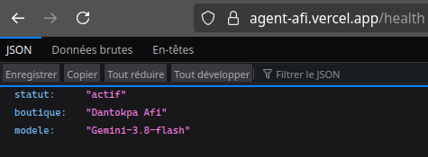
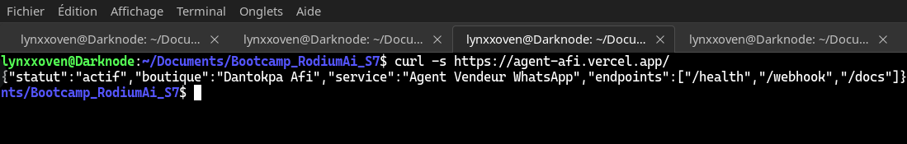
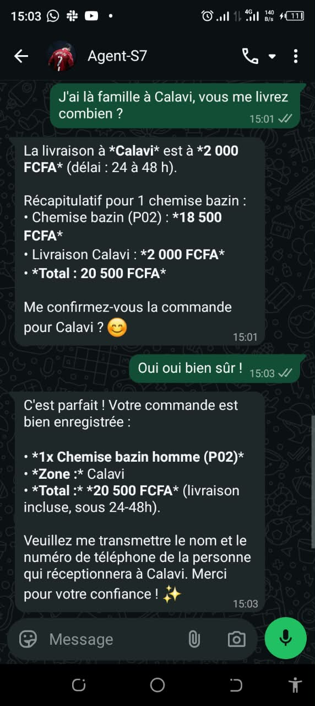

# Boutique Intelligente — Agent Vendeur WhatsApp (Dantokpa)

Projet d'ingénierie logicielle pour l'automatisation d'une boutique de pagnes et d'accessoires au marché Dantokpa (Cotonou, Bénin) sur WhatsApp. L'agent dialogue avec les clients, consulte le catalogue, calcule la livraison, convertit les monnaies, répond aux questions via RAG, et soumet les commandes à la validation humaine d'Afi.

Projet réalisé dans le cadre de la **Session 7 du Bootcamp RodiumAi**.

---

## 1. Organisation du Répertoire

Le projet est organisé en 3 grandes phases et chaque phase est isolée dans son sous-dossier technique dédié :

```
Bootcamp_RodiumAi_S7/
│
├── .gitignore
├── Exo_SESSION7_RodiumAi.pdf         # Cahier des charges officiel
├── README.md
│
├── articles/                         # Base documentaire pour le RAG
│   └── guide_boutique.md             # Guide officiel : entretien, tailles, retours, horaires
│
├── numero_1/                         # Palier 1 : Agent ReAct Unitaire & Outils
│   ├── catalogue.py                  # Références (P01 à P06) et zones (Cotonou, Calavi...)
│   ├── outils.py                     # 5 outils officiels + outil RAG
│   ├── agent.py                      # Boucle penser-agir-observer-évaluer (Gemini-3.8-flash)
│   ├── tests.py                      # 4 tests obligatoires du palier 1
│   └── README.md                     # Documentation Palier 1
│
├── numero_2/                         # Palier 2 : Fiabilité, Persistance & Multi-Agents
│   ├── donnees/                      # Stockage persistant JSON (stock.json, commandes.json)
│   ├── fiabilite/                    # Palier 2a : Validation humaine [o/N], double évaluation
│   ├── multiagents/                  # Palier 2b : Gérant, Vendeur, Logisticien, Rédacteur
│   ├── comparaison.py                # Benchmark Agent Seul vs Multi-Agents
│   ├── tableau.md                    # Tableau comparatif et justification technique
│   └── README.md                     # Documentation Palier 2
│
└── numero_3/                         # Palier 3 : Production WhatsApp & Garde-fous
    ├── config.py                     # Configuration des tokens et paramètres
    ├── securite.py                   # Dédoublonnage, limiteur de débit, anti-injection
    ├── validation.py                 # Workflow interactif WhatsApp pour Afi (OUI / NON)
    ├── client_green_api.py           # Client HTTP Green API (sendMessage)
    ├── serveur.py                    # API FastAPI de réception Webhook et BackgroundTasks
    ├── tests_production.py           # Suite des 7 tests de mise en production
    └── README.md                     # Guide de déploiement et mise en ligne
```

---

## 2. Principes Techniques & Garde-fous

1. **Modèle de Langage & Température** :
   - Modèle : `google/gemini-3.8-flash` via l'API RodiumAI (`https://api.rodiumai.io/v1`).
   - Température : `0.1` pour garantir un comportement déterministe et éliminer toute hallucination sur les prix ou les stocks.
2. **Optimisation des Coûts (Tokens)** :
   - Contexte glissant borné aux **12 derniers messages** par client.
   - Plafond d'étapes (`max_steps = 10`) pour prévenir toute boucle infinie.
3. **Retrieval-Augmented Generation (RAG)** :
   - Outil `consulter_guide_boutique` interrogeant l'article `articles/guide_boutique.md` pour ancrer les conseils d'entretien du wax et la politique d'échange dans la documentation de la boutique.
4. **Intégrité Arithmétique & Double Évaluation** :
   - Règle de code arithmétique validant $\text{Total} = \sum \text{Articles} + \text{Livraison}$.
   - LLM Juge évaluant le strict respect de l'absence de chiffres inventés et la concision ($\le 80$ mots).
5. **Garde-fous de Production (FastAPI + Green API)** :
   - Dédoublonnage d'identifiants de messages (`idMessage`).
   - Validation exclusive par WhatsApp d'Afi pour chaque commande.
   - Protection contre les attaques par injection de prompt.

---

## 3. Installation et Exécution Rapide

### Prérequis
- Python 3.10+
- Clé d'API RodiumAI configurée dans `.env` :
  ```env
  RODIUMAI_API_KEY=rd_sk_prod_...
  BASE_URL=https://api.rodiumai.io/v1
  ```

### Lancement des Tests par Palier

```bash
# Palier 1 : Agent ReAct unitaire
./venv/bin/python numero_1/tests.py

# Palier 2 : Fiabilité et validation humaine
./venv/bin/python numero_2/fiabilite/tests_fiabilite.py

# Palier 2 : Multi-agents et benchmark
./venv/bin/python numero_2/multiagents/tests_multiagents.py

# Palier 3 : Tests de mise en production WhatsApp
./venv/bin/python numero_3/tests_production.py
```

### Lancement du Serveur de Production WhatsApp (Palier 3)

Pour exécuter le serveur FastAPI et écouter les requêtes Webhook en local :

```bash
./venv/bin/uvicorn numero_3.serveur:app --host 127.0.0.1 --port 8000 --reload
```

* **Vérification de santé** : [http://127.0.0.1:8000/health](http://127.0.0.1:8000/health)
* **Documentation & Test interactif Swagger** : [http://127.0.0.1:8000/docs](http://127.0.0.1:8000/docs)
* **Endpoint Webhook Green API** : `POST http://127.0.0.1:8000/webhook` (avec header `Authorization: <VOTRE_WEBHOOK_SECRET_TOKEN>`)

---

## 4. Architecture de Déploiement en Production

Pour assurer un fonctionnement 24h/24 sans dépendance à une machine locale :
* **Hébergement Cloud** : Déployée sur **Vercel** via l'environnement Serverless Python natif (`@vercel/python`) avec configuration d'exécution optimisée ([vercel.json](file:///home/lynxxoven/Documents/Bootcamp_RodiumAi_S7/vercel.json)) et terminaison HTTPS globale.
* **Point d'Entrée ASGI** : Point d'accès centralisé dans [api/index.py](file:///home/lynxxoven/Documents/Bootcamp_RodiumAi_S7/api/index.py) chargeant l'application FastAPI et assurant la liaison avec les modules métier.
* **Passerelle WhatsApp** : Connectée à l'API **Green API** via un endpoint Webhook sécurisé (`/webhook`) avec authentification par jeton secret (`Authorization`) et traitement événementiel asynchrone (`BackgroundTasks`).
* **Supervision & API** : Surveillance via la sonde `/health` et interface de test interactive OpenAPI disponible sur `/docs`.

---

## 5. Démonstration & Captures d'Écran en Production

### 5.1 Vérification des Endpoints en Ligne (Vercel)

| Sonde de Santé (`/health`) | Test Webhook Sécurisé (`curl`) |
| :---: | :---: |
|  |  |

### 5.2 Démonstration Réelle des Échanges WhatsApp

| 1. Consultation & Catalogue | 2. Prise de Commande & Calculs | 3. Validation Humaine par Afi |
| :---: | :---: | :---: |
|  |  |  |

---

## 6. Contact & Support

Pour toute question, démonstration ou intégration relative à ce projet :
* **WhatsApp** : [+228 71 37 97 48](https://wa.me/22871379748)
